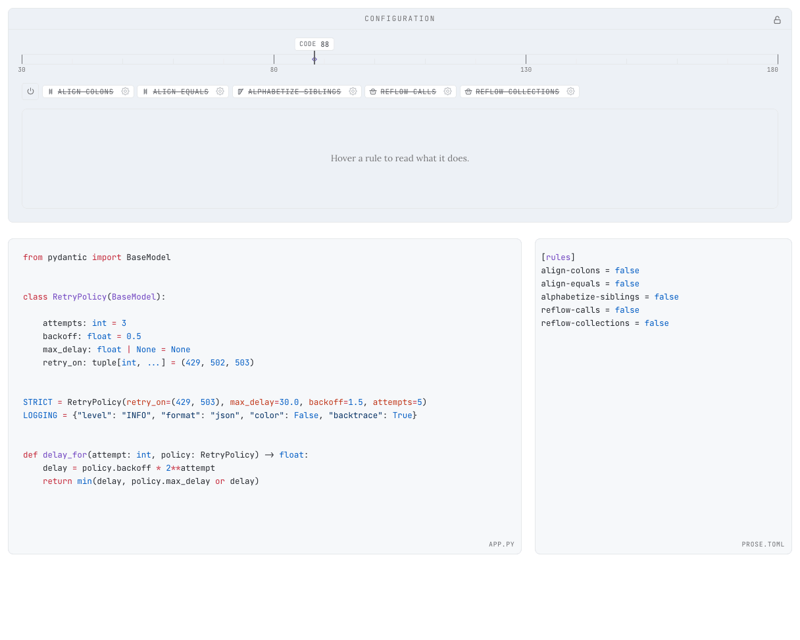
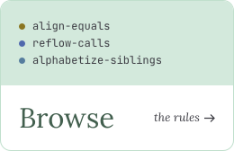
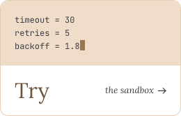

<div align="center">


[](https://www.rust-lang.org/)
[](https://www.python.org/)
[](https://codecov.io/gh/Jybbs/prose)
[](https://prose.fyi/)

</div>

---

## 🪻 About

***Prose*** formats Python source to be *legible at a glance*. It aligns equals signs and colons vertically across consecutive lines, places one entry per line in dictionaries, calls, and signatures, alphabetizes methods and fields within their groups, removes padding that lines up with nothing, and treats code like prose rather than minified text.

<p>
<picture><source media="(prefers-color-scheme: dark)" srcset="../site/public/readme/sandbox-dark.gif"></picture>
</p>

> [!NOTE]
> ***Prose*** is still pre-1.0. The rule catalog and configuration facets continue to grow across release lines.

---

## 🗞️ Philosophy

Code is read far more often than it is written, and a reader's eye moves down a page and across adjacent lines looking for parallels, patterns, and **shape**. The [landing page](https://prose.fyi/) sets out how ***Prose*** restores that shape.

The trade-offs minimalist formatters were built to avoid (*wider diffs, more vertical scrolling, occasional re-alignment churn*) no longer dominate the equation. Agentic assistants do much of the typing, and every modern code host offers whitespace-ignoring diffs. What remains is the daily experience of reading code.

---

## 🪄 Install & Usage

```bash
uv tool install prose-formatter
```

The binary exposes `format`, `check`, `rules`, `server`, `cache`, `completions`, and `schema`:

```bash
prose format path/             # rewrite files in place
prose check path/              # exit non-zero on violations
prose format --diff path/      # show the diff without writing
prose check --stdin < file.py  # read from stdin
prose format - < file.py       # `-` reads from stdin too
prose rules                    # list the rules in pipeline order
prose schema                   # print the config's JSON Schema
prose server                   # language server over stdio
```

---

## 📰 Start Here

<p align="center">
<a href="https://prose.fyi/guide/"><picture><source media="(prefers-color-scheme: dark)" srcset="../site/public/readme/read-dark.svg"></picture></a>
<a href="https://prose.fyi/rules/"><picture><source media="(prefers-color-scheme: dark)" srcset="../site/public/readme/browse-dark.svg"></picture></a>
<a href="https://prose.fyi/sandbox/"><picture><source media="(prefers-color-scheme: dark)" srcset="../site/public/readme/try-dark.svg"></picture></a>
</p>

- Turn a rule off for a whole project, or set its facets, in `prose.toml` or `[tool.prose]` with the [**configuration reference**](https://prose.fyi/reference/configuration)
- Keep a hand-shaped block exactly as written with `# fmt: off` or `# fmt: skip` from the [**suppression directives**](https://prose.fyi/reference/suppression-directives)
- Gate CI on formatting with the codes `prose check` returns in the [**exit-code matrix**](https://prose.fyi/reference/exit-codes)
- Format on save, in pre-commit, or in CI through the [**integrations**](https://prose.fyi/integrations/)
- Run ***Prose*** beside Ruff with the `extend-ignore` codes on the [**Ruff page**](https://prose.fyi/integrations/ruff)
- Start a run with nothing stored through `--no-cache` or `prose cache clean` from the [**cache reference**](https://prose.fyi/reference/cache)

---

## 🗜️ Development

*Prose* is a Rust crate that ships as a Python wheel through [**maturin**](https://www.maturin.rs/), with [**mise**](https://mise.jdx.dev) managing the Rust toolchain, Python interpreter, and every supporting CLI through a single mise config. After installing mise and [**activating it in your shell**](https://mise.jdx.dev/installing-mise.html), the rest provisions from a clone. `mise doctor project` then reports anything a build still needs beyond the tools, each beside the command that supplies it:

```bash
git clone https://github.com/Jybbs/prose.git
mise trust prose
mise -C prose install
cd prose
mise doctor project
```

Once mise's shell hook has put `.mise/bin` on the path, a bare `prose` inside the checkout runs the checkout's own build rather than an installed release.

`mise tasks` lists every available task, and `mise ci` runs the full local sweep that mirrors GitHub Actions. The contributor guide at `.github/CONTRIBUTING.md` walks a change from setting up a clone and filing or picking up an issue, through the fixture case a fix is reviewed against and the commit, to the pull request and the checks that run on it.

For the architecture, the [**architecture section**](https://prose.fyi/architecture/) walks the types and modules *Prose* is built from, setting the public `Source`, `Pipeline`, and `RuleId` beside the shared pieces every rule is composed from, and the [**pipeline order**](https://prose.fyi/reference/pipeline-order) sets out the fixed order the rules run in and why each rule sits where it does.
